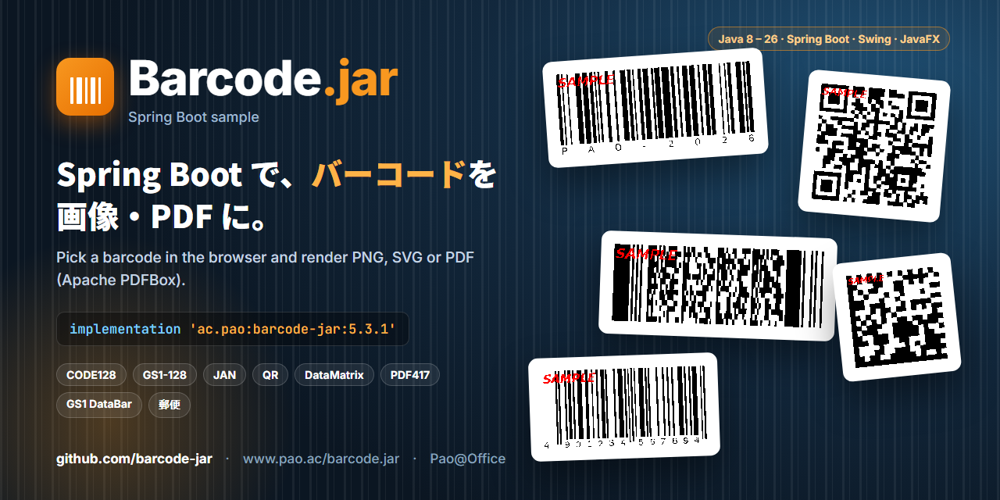
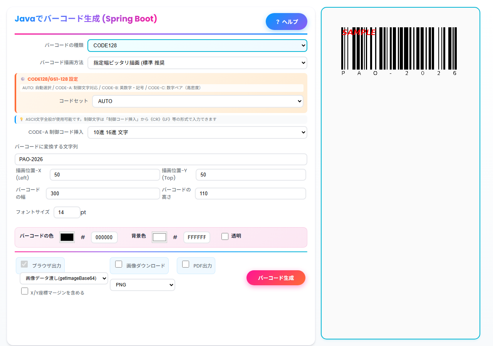
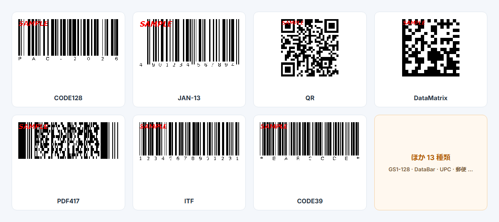
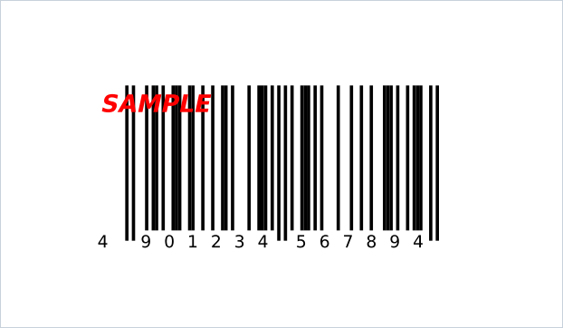

<p align="center">
  
</p>

<p align="center">
  <a href="https://central.sonatype.com/artifact/ac.pao/barcode-jar"></a>
  
  
  
  <a href="LICENSE"></a>
</p>

# Barcode.jar Spring Boot サンプル

**[Barcode.jar](https://www.pao.ac/barcode.jar/)** は、Java でバーコードを描くライブラリです。このサンプルは Spring Boot の Web アプリで、ブラウザからバーコードの種類と値を選び、PNG・JPEG・BMP・SVG の画像や PDF に出力します。

> [!NOTE]
> Maven Central の `ac.pao:barcode-jar` は **体験版** で、出力に赤い「SAMPLE」の印が付きます。QR コードなど 2 次元のコードは、印が重なるため読み取れないことがあります。[製品版](https://www.pao.ac/barcode.jar/buy.html)では印が消えます。

<p align="center"></p>

## すぐに動かす

```bash
git clone https://github.com/barcode-jar/springboot.git
cd springboot
docker compose up -d --build        # Docker で起動
```

ブラウザで **http://localhost:5000/barcode** を開きます。止めるときは `docker compose down` です。

Docker を使わない場合は、Java 17 以降で次のとおりです。

```bash
./gradlew bootRun                   # Windows は gradlew.bat bootRun
```

## Java の版とサンプル

| Java の版 | 画面（デスクトップ）のサンプル | Web のサンプル | 入手先 |
|---|---|---|---|
| Java 17 以上 | JavaFX 21.0.6（[barcode-jar/javafx](https://github.com/barcode-jar/javafx)） | Spring Boot 3.5.16（このリポジトリ） | GitHub・体験版 ZIP（barcode.jar.17.zip） |
| Java 8・11 | Swing | Spring Boot 2.7.18 | [体験版 ZIP](https://www.pao.ac/barcode.jar/)（barcode.jar.8.zip・barcode.jar.11.zip） |

このリポジトリは Spring Boot 3.5.16・Java 17 以上です。Java 8・11 では Spring Boot 3 が動かないため、Spring Boot 2.7.18 の版を体験版 ZIP に入れています。PDF は、どちらも Apache PDFBox 3.0.8 で作ります。

## 対応バーコード（20 種類）

<p align="center"></p>

| 分類 | バーコード |
|---|---|
| 1 次元 | CODE128、GS1-128、CODE39、CODE93、NW7（Codabar）、ITF、Matrix 2of5、NEC 2of5 |
| 商品コード | JAN-13、JAN-8、UPC-A、UPC-E、GS1 DataBar（標準型・限定型・拡張型） |
| 2 次元 | QR コード、DataMatrix（GS1 対応）、PDF417 |
| 日本の業務用 | コンビニ収納代行（GS1-128）、郵便カスタマバーコード |

## あなたのプロジェクトで使う

**Gradle**

```gradle
dependencies {
    implementation 'ac.pao:barcode-jar:5.3.1'
}
```

**Maven**

```xml
<dependency>
  <groupId>ac.pao</groupId>
  <artifactId>barcode-jar</artifactId>
  <version>5.3.1</version>
</dependency>
```

**コード例**（Graphics2D に描いて PNG に保存）

```java
BufferedImage img = new BufferedImage(360, 160, BufferedImage.TYPE_INT_RGB);
Graphics2D g = img.createGraphics();
g.setColor(Color.WHITE);
g.fillRect(0, 0, img.getWidth(), img.getHeight());

Code128 bar = new Code128(g);              // pao.barcode.Code128
bar.draw("PAO-2026", 20, 20, 320, 110);    // 値, X, Y, 幅, 高さ
g.dispose();

ImageIO.write(img, "png", new File("code128.png"));
```

Graphics2D に描けるので、画面・印刷・PDF のどこにでも同じ方法で出力できます。

## PDF 出力

PDF は [Apache PDFBox](https://pdfbox.apache.org/)（Apache License 2.0）で作ります。方法は 2 つあります。

- **Graphics2D で直接描く**：[pdfbox-graphics2d](https://github.com/rototor/pdfbox-graphics2d) の `PdfBoxGraphics2D` に Barcode.jar で描きます。拡大しても線がにじまないベクター形式です。
- **画像を貼る**：バーコードの PNG を作って PDF に配置します。

<p align="center"></p>

## ファイル構成

| ファイル | 内容 |
|---|---|
| `src/main/java/.../util/BarcodeUtil.java` | バーコードを作る処理（種類ごとの設定、画像・SVG・PDF の出力） |
| `src/main/java/.../Controller/BarcodeController.java` | 画面の受け付けと出力の切り替え |
| `src/main/resources/templates/barcode.html` | 画面（Thymeleaf） |

## ライセンス

- このリポジトリのサンプルコード：MIT（[LICENSE](LICENSE)）
- Barcode.jar（`ac.pao:barcode-jar`）：Pao@Office の使用許諾。Maven Central のものは体験版です。
- Apache PDFBox・pdfbox-graphics2d：Apache License 2.0

---

# Barcode.jar Spring Boot sample (English)

**[Barcode.jar](https://www.pao.ac/barcode.jar/)** is a barcode library for Java. This Spring Boot web app lets you pick a barcode type and value in the browser and render it as PNG, JPEG, BMP, SVG or PDF.

> [!NOTE]
> `ac.pao:barcode-jar` on Maven Central is a **trial edition**: output carries a red "SAMPLE" mark (2D codes such as QR may not scan because of it). The [licensed edition](https://www.pao.ac/barcode.jar/) has no mark.

### Run

```bash
git clone https://github.com/barcode-jar/springboot.git && cd springboot
docker compose up -d --build     # or: ./gradlew bootRun  (Java 17+)
```

Open **http://localhost:5000/barcode**.

### Java versions

Java 17+: this repository (Spring Boot 3.5.16) and the [JavaFX sample](https://github.com/barcode-jar/javafx). Java 8 / 11: Spring Boot 2.7.18 and Swing samples are in the [trial ZIP](https://www.pao.ac/barcode.jar/) (barcode.jar.8.zip / barcode.jar.11.zip).

### Use it in your project

```gradle
implementation 'ac.pao:barcode-jar:5.3.1'
```

```java
Code128 bar = new Code128(graphics2d);      // draw on any Graphics2D
bar.draw("PAO-2026", 20, 20, 320, 110);     // value, x, y, width, height
```

20 barcode types: CODE128, GS1-128, CODE39, CODE93, NW7/Codabar, ITF, Matrix 2of5, NEC 2of5, JAN-13/8, UPC-A/E, GS1 DataBar (3 kinds), QR, DataMatrix, PDF417, Japanese convenience-store and postal barcodes. PDF output uses Apache PDFBox.

### License

Sample code: MIT. Barcode.jar: Pao@Office license (trial on Maven Central). Apache PDFBox / pdfbox-graphics2d: Apache License 2.0.
